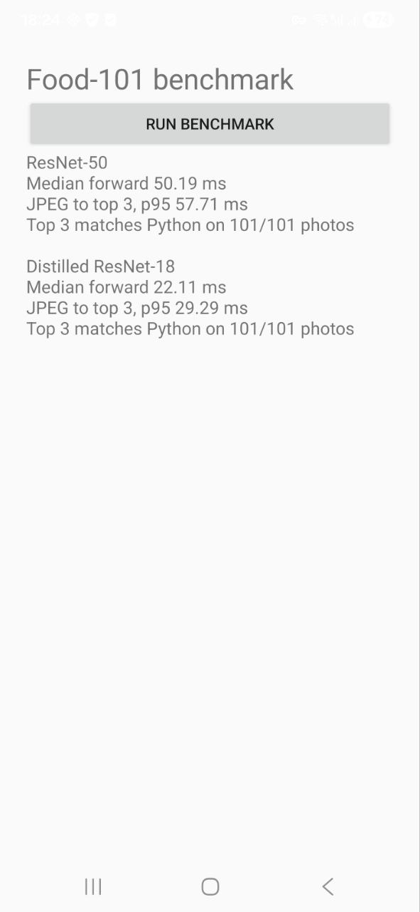
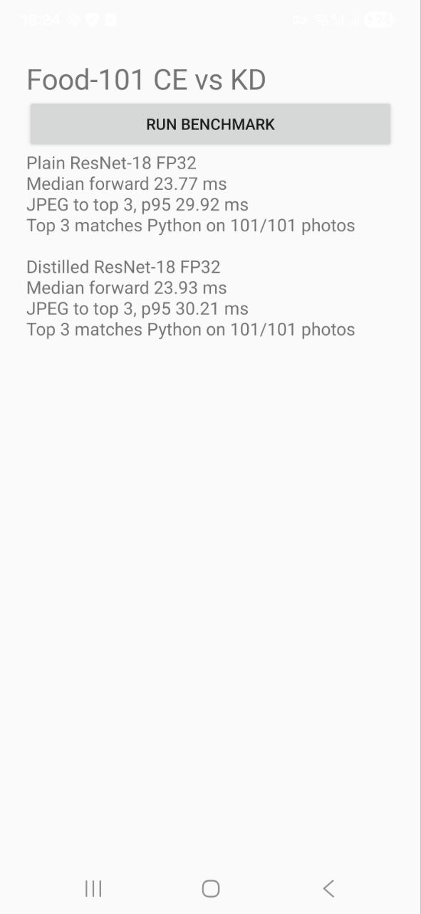
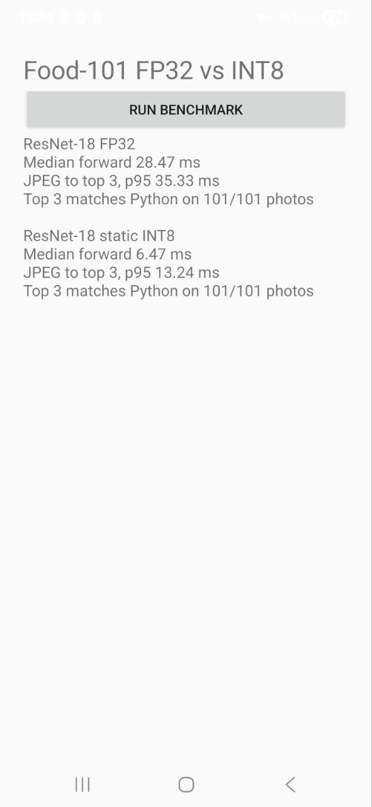

## Распознавание блюд на смартфоне

Пользователь фотографирует обед в Android-приложении и выбирает название блюда из трёх подсказок. Приложение сохраняет блюдо в дневнике питания, который можно использовать для подсчёта калорий. Для обучения и проверки моделей я использую Food-101 — 101 000 фотографий блюд из 101 категории. Качество оцениваю по top-3 — доле тестовых фотографий, для которых правильное название вошло в тройку подсказок. Ожидаемая нагрузка — несколько запросов за приём пищи от одного пользователя. Дополнительное возможное применение модели - каталогирование меню ресторана выездным сотрудником компании по доставке еды, нагрузка в данном случае может достигать сотен фото в день.

Модель должна запускаться на Android-смартфоне и распознавать блюда без интернета. Поскольку курс «Дистилляция и ускорение моделей» посвящён тому, как сделать модели компактнее и быстрее, в этой работе я фокусируюсь на точности предсказаний, времени ожидания ответа и размере файла модели на устройстве.

Исходная модель — ResNet-50, уже обученная распознавать 101 категорию блюд. На Galaxy S24+ Android приложение обрабатывает по одному снимку на четырёх потоках CPU. Цель после прогрева — уложиться в 300 мс для 95% запросов. Допустимое отставание от исходной модели — не более 3 процентных пунктов по предсказанию top-3. Время быдем отсчитывается от открытия JPEG до получения трёх названий.

**Где ResNet-50 тратит время?** Сначала я измерил время каждого этапа на 505 снимках на ноутбуке с Intel CPU (Core i7-1165G7). Медиана декодирования JPEG составила 3,02 мс, подготовки входа — 3,21 мс, прямого прохода сети — 102,62 мс. Круговая диаграмма показывает долю каждого этапа в суммарном времени обработки всех снимков.

[Рисунок: jpeg-stages-v5]

На прямой проход ResNet-50 пришлось 93,62% суммарного времени обработки фотографий. Поэтому я посмотрел, на что сеть тратит время внутри. В исходном профиле на Intel CPU на свёртки пришлось 73,1% собственного времени процессора. Больше всего времени в сумме заняли свёртки 1×1: сеть выполняла их 36 раз за снимок, в среднем по 42,8 мс на все вызовы вместе. Отсюда возник вопрос: насколько ускорится распознавание, если выбрать архитектуру, которой нужно меньше таких преобразований?

## Выбор архитектуры

Обе сети получают одно и то же RGB-изображение 224×224. В начале они выделяют простые признаки, затем обрабатывают их на четырёх масштабах — от карты 56×56 до 7×7. В конце сеть усредняет каждый канал и выдаёт 101 оценку, по одной на блюдо.

Профилирование ResNet-50 на ноутбуке показало, что среди свёрток больше всего времени в сумме заняли свёртки 1×1. Поэтому для ученика я выбрал архитектуру снижаюшую их количество относительно учителя. Во-первых, число блоков в четырёх стадиях сократилось с [3, 4, 6, 3] до [2, 2, 2, 2]. Во-вторых, в каждом блоке вместо последовательности 1×1 → 3×3 → 1×1 используются две свёртки 3×3, т.е. в ее основной ветви свёрток 1x1 нет. Остаточные связи сохранились. Из 36 свёрток 1×1 остались три — по одной на каждом переходе между стадиями, где перед сложением нужно согласовать размеры тензоров. Вуаля, мы получили более компактную архитектуру ученика известную под названием ResNet-18. ResNet-50 я использовал как учителя при дистилляции.

[Рисунок: architecture-stages-v5. Подпись: «Среднее за 16 проходов после 20 прогревов на Intel CPU (Core i7-1165G7), FP32, четыре потока, batch 1. От готового тензора до 101 логита прошло 88,92 мс у ResNet-50 и 36,25 мс у ResNet-18. Стадии включают обе ветви, BatchNorm, ReLU и сложение. Больше всего времени сэкономила стадия 3 — **18,85 мс за проход**.».]

[Рисунок: conv-groups-v5. Подпись: «На с. 1 показан исходный замер: 42,8 мс на все 36 свёрток 1×1 учителя. В повторном замере с именами слоёв — **48,61 мс в основной ветви и 10,69 мс в остаточной**. Обе модели получили те же 16 входных тензоров; время свёрток измеряли отдельно от времени стадий.».]

Самая большая разница пришлась на основную ветвь блоков. У ResNet-50 её 32 свёртки 1×1 вместе занимали 48,61 мс за проход. У ResNet-18 в основной ветви таких свёрток нет.

## Как изменились размер сети и объём вычислений

У обеих сетей одинаковая входная свёртка. Затем идут четыре стадии с разным числом блоков и каналов. Для каждой части сети я посчитал обучаемые параметры и число умножений с накоплением (MAC) на один снимок 224×224.

[Рисунок: parameter-profile-v5. Подпись: «Каждая стадия включает обе ветви блока. Для BatchNorm посчитаны масштаб и смещение на каждый канал, для классификатора — веса и смещения выходов по всем 101 классам.».]

Число параметров сократилось с 23,715 до 11,228 млн (см. разбивку на диаграмме выше). Наибольший вклад дала стадия 4: на неё пришлось **6 571 008 из 12 486 656** исключённых параметров.

На один снимок требуется 4,087 млрд MAC у ResNet-50 и 1,814 млрд у ResNet-18. Наибольшее сокращение вычислений пришлось на стадию 3 — **1,053 млрд MAC на снимок**. На этой же стадии профиль на Intel CPU показал наибольшее сокращение времени — **18,85 мс за проход**. Размер выходного тензора первой стадии в FP32 уменьшился с 3,06 до 0,77 МиБ.

В тесте на Intel CPU до обучения ученика медиана прямого прохода составила 102,62 мс у ResNet-50 и 42,56 мс у ResNet-18.

## Экспериментальная оценка эффекта дистилляции знаний

Для экспериментального подтверждения эффекта от вышеописанных изменений я обучил два одинаковых ResNet-18. Первый учился по правильным меткам Food-101: для снимка пиццы ответом была «пицца». Второй видел ещё и распределение вероятностей ResNet-50 по всем 101 блюдам. Оно подсказывало, какие варианты учитель считал похожими. Такой способ обучения называется дистилляцией знаний. Во время работы приложения ученику учитель уже не нужен.

У обоих учеников совпадали начальные веса, порядок изображений, аугментации и бюджет обучения. Отличалась только функция потерь. На RTX 4070 Ti SUPER для обучения использовалось 70 700 снимков, для выбора чекпойнта — ещё 5 050. Итоговое качество измерялось на отдельном официальном тесте из 25 250 фотографий.

**Функция потерь.** Обычный ученик минимизировал кросс-энтропию (CE) по меткам. Для дистилляции использовалась сумма `0,5·CE + 0,5·T²·KL(p_учителя || p_ученика)`, где `T = 2`. Обе модели получали один и тот же аугментированный снимок. Веса учителя были заморожены.

| Модель | Top-1, % | Top-3, % |
|---|---:|---:|
| Учитель ResNet-50 | 85,897 | 95,176 |
| ResNet-18, обучение по меткам | 81,335 | 92,978 |
| ResNet-18, дистилляция | 82,444 | 93,628 |

В парном сравнении при seed 42 дистилляция дала **164 дополнительных попадания в тройку**: ученик исправил 487 промахов и потерял 323 прежних попадания. На телефоне оба ученика занимали 44,91 МБ, а медиана прямого прохода составила 21,36 и 21,32 мс. Дистилляция улучшила подсказки, сохранив стоимость вычислений компактной сети.

## Экспериментальная оценка эффекта квантизации

Затем я взял уже обученного ученика и подготовил две версии для телефона. Первая использовала FP32. Для второй я выполнил статическую квантизацию в INT8 без дообучения. Диапазоны активаций оценивались на 505 фотографиях из обучающей выборки, по пять на класс. В итоговом файле ExecuTorch все 20 свёрток и последний линейный слой выполняются в INT8 через XNNPACK.

FP32 и INT8 обработали одни и те же 101 JPEG на Galaxy S24+ (SM-S926B, Android 16). Обе версии работали с входом 224×224, по одному снимку за раз, на четырёх потоках XNNPACK. Каждый запуск начинался с прогрева. Энергосбережение было выключено.

[Рисунок: phone-profile-v5. Подпись: «Слева — среднее время четырёх этапов по 101 фото на вариант в инструментированном замере. Справа — распределение задержки JPEG → top-3 в отдельном замере: три запуска по 101 фото, 303 запроса на вариант.».]

В замере на 303 запросах медиана прямого прохода сократилась **с 21,43 до 4,99 мс**, в 4,3 раза. Полный запрос ускорился в 2,4 раза: **p95 снизился с 27,90 до 11,60 мс**. Средние длительности этапов из замера на 101 фото приведены в таблице.

| Среднее время этапа на Galaxy S24+, мс | FP32 | INT8 |
|---|---:|---:|
| Открытие JPEG, декодирование и извлечение RGB | 2,287 | 2,174 |
| Масштабирование, кроп, нормализация и создание тензора | 1,828 | 1,820 |
| Прямой проход | 21,413 | 5,277 |
| Выбор трёх названий | 0,047 | 0,047 |

У INT8 почти 4 мс уходит на декодирование JPEG и подготовку тензора. Вместе с выбором top-3 это 43,4% среднего времени запроса. Путь от JPEG до входного тензора остаётся важным местом для оптимизации: приложение проходит его при каждом запросе, независимо от скорости нейросети. Ускорение этого этапа выходит за рамки работы по данному курсу.

## Проверка приложения на Galaxy S24+

На телефоне в Android приложении я запускал три парных теста. В каждом тесте приложение распознавало 101 фотографию и сверяло три предсказанных названия с результатом той же модели в Python. На всех трёх экранах виден результат проверки: для каждого варианта тройки совпали на 101 снимке из 101.

На экранах показано время отдельных запусков. В таблице приведены сводные результаты сравнения архитектур, способов обучения и точности вычислений.

| Что меняли | Что показал парный замер |
|---|---|
| Архитектура: ResNet-50 → дистиллированная ResNet-18, обе FP32 | p95 полного запроса 67,57 → 33,51 мс, снижение на 50,4% |
| Обучение: метки → дистилляция, обе ResNet-18 FP32 | Top-3 92,978% → 93,628%; медиана прямого прохода 21,36 → 21,32 мс |
| Точность вычислений: FP32 → INT8, один чекпойнт ученика | p95 27,90 → 11,60 мс; файл 44,91 → 11,31 МБ; на полном тесте на два попадания в тройку меньше |

Каждая строка — отдельное сравнение на одних и тех же фотографиях внутри пары. Для итоговых оценок FP32 и INT8 использовались экспортированные файлы; равенство оценок классов разрешалось по меньшему индексу. Top-1 после квантизации изменился с 82,444% до 82,372%. У одного FP32-ученика p95 составил 33,51 мс в сравнении архитектур и 27,90 мс в сравнении точности вычислений. Проценты ускорения рассчитаны внутри соответствующей пары.

## Выбор модели для телефона

Для офлайн-дневника наиболее предпочтительным кажется использование **дистиллированной ResNet-18 в INT8**. На Galaxy S24+ задержка от открытия JPEG до выдачи трёх подсказок по p95 составила 67,57 мс у учителя ResNet-50 в FP32 и 11,60 мс у INT8-ученика. Полный запрос стал короче **на 55,97 мс (82,8%)**. Медиана времени самого прямого прохода снизилась с 50,92 до 4,99 мс — **на 45,93 мс (90,2%)**.

Учителя и INT8-ученика измеряли в отдельных сериях на одном телефоне. В обеих сериях приложение использовало четыре потока CPU и один и тот же набор из 101 фотографии. Для учителя измерен один проход (101 запрос), для INT8-ученика — три прохода (303 запроса).

Файл модели занимает 11,31 МБ вместо 94,80 МБ у учителя. **Экономия на телефоне — 83,49 МБ (88,1%)**. Цена этого выигрыша на полном тесте Food-101 — снижение точности top-3 с 95,176% до 93,620%, или **на 1,56 процентного пункта**. Из 25 250 фотографий верное блюдо вошло в тройку у учителя на 24 032 снимках, у ученика — на 23 639. Это на 393 попадания меньше. Отставание ученика оказалось в пределах заданных 3 процентных пунктов от учителя.

Дальнейшим этапом развития данной работы было бы интересно проверить работу модели на реальных данных с телефона, а также выяснить позволят ли другие методы квантования и дистилляции повысить качество получаемой модели.

**Источники и код.** [ResNet](https://arxiv.org/abs/1512.03385) · [Food-101](https://data.vision.ee.ethz.ch/cvl/datasets_extra/food-101/) · [Чекпойнт учителя](https://huggingface.co/ilian-hadzhidimitrov/food-classifier-resnet50#food-101-only-baseline-variant) · [Дистилляция знаний](https://arxiv.org/abs/1503.02531) · [Квантизация в ExecuTorch](https://docs.pytorch.org/executorch/stable/backends/xnnpack/xnnpack-quantization.html).
